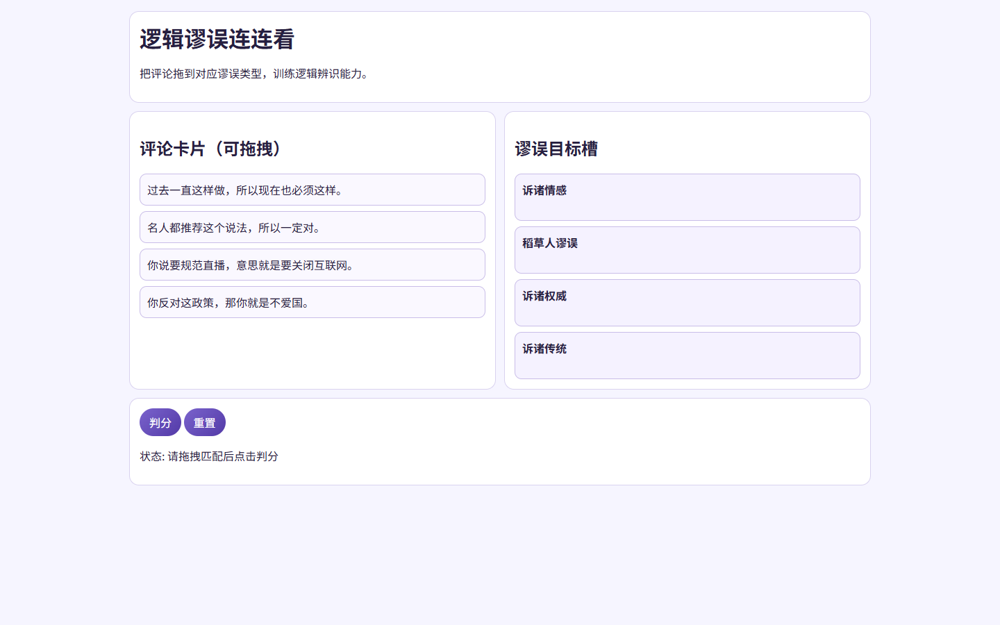

# P29 逻辑谬误连连看

用一组“评论卡片 → 谬误类型”的匹配训练识别常见逻辑谬误：桌面端可拖拽，移动端可用“下拉归类”。支持学习/复习（弱项优先）、错题汇总与谬误图鉴。

## 使用方法

1. 选择关卡规模与模式（学习 / 复习弱项优先）
2. 将卡片归类到右侧目标槽
   - 桌面端：拖拽
   - 移动端：卡片下拉选择
3. 点击“判分”查看正确率与本关错题（含解析与反问）
4. 点击“解释”或“图鉴 / 汇总”学习定义、识别信号与反制提问

## 功能

- 学习/复习两模式（复习弱项优先）
- 即时判定开关（归类时提示对/错）
- 本关错题汇总（解析 + 反问）
- 图鉴/汇总（掌握度、搜索、弱项/已掌握过滤）
- 本机进度保存与一键重置（`localStorage`）

## 题库

- 内置谬误类型：16 种
- 静态题库示例：32 题（可在 `projects/P29-fallacy-match/app.js` 内扩展）

## 隐私说明

进度与掌握度仅保存在本机浏览器（`localStorage`），不会上传。


## 已知限制

- 仅支持现代 Chromium 内核浏览器 (Chrome 110+, Edge 110+)。
- 题目数量有限。
- 本工具为前端纯静态实现，不含后端服务。
## 产品化优化（PM）

### 优化目标
- 降低核查操作复杂度，缩短结论产出时间。

### 目标用户
- 一线用户：希望在 3 分钟内完成核心任务的内容/数据/核查从业者。
- 管理者：关注输出质量稳定性、效率提升和可复用流程。

### 核心使用场景
- 核查任务中快速定位风险点
- 多源交叉验证降低误判
- 沉淀可复用核查步骤

### 北极星指标（上线后 2 周）
- 首次任务完成率 >= 70%
- 核心任务完成时长 P50 <= 3 分钟
- 7 日回访率 >= 20%

### 下一步迭代（按优先级）
1. 增加证据链可视化
2. 补齐关键核查模板与说明
3. 提供结论摘要与引用导出

## 数据化追踪（PM）

### 已接入埋点事件
- `page_view`：页面访问
- `first_interaction`：首次交互时延
- `cta_click`：核心按钮点击
- `task_start` / `task_complete` / `task_error`：核心任务生命周期
- `status_success_signal` / `status_error_signal`：状态文本成功/失败信号
- `page_hidden` / `page_unload`：页面停留与离开

### 看板字段（统一）
- `project_id`（例如：P29-fallacy-match）
- `project_cluster`
- `session_id`
- `event_name`
- `event_time`
- `page_path`
- `control_id`
- `task_name`（当前项目默认：verification_core_task）
- `task_duration_ms`
- `elapsed_ms`
- `status_text`

### 本地查看与导出
在浏览器控制台执行：

```js
window.pmMetrics.getSummary()
window.pmMetrics.exportEvents()
```

### 上线后两周目标
- 首次交互时延 P50 <= 10 秒
- 核心任务完成率 >= 70%
- 核心任务完成时长 P50 <= 180 秒

<!-- PLAYWRIGHT_REVIEW:START -->
## 页面效果截图（Playwright）

> Captured: 2026-03-02T09:19:19.915Z | Mode: headed (non-headless)



## 可改进点（自动巡检）
- 增强首屏任务引导与主按钮文案，提升首次任务启动率。
- 补充空状态和错误状态指引，减少用户中断。

- 巡检信号：console_error=0，request_failed=0，load_ms=2580
- 页面标题：P29 逻辑谬误连连看

<!-- PLAYWRIGHT_REVIEW:END -->

